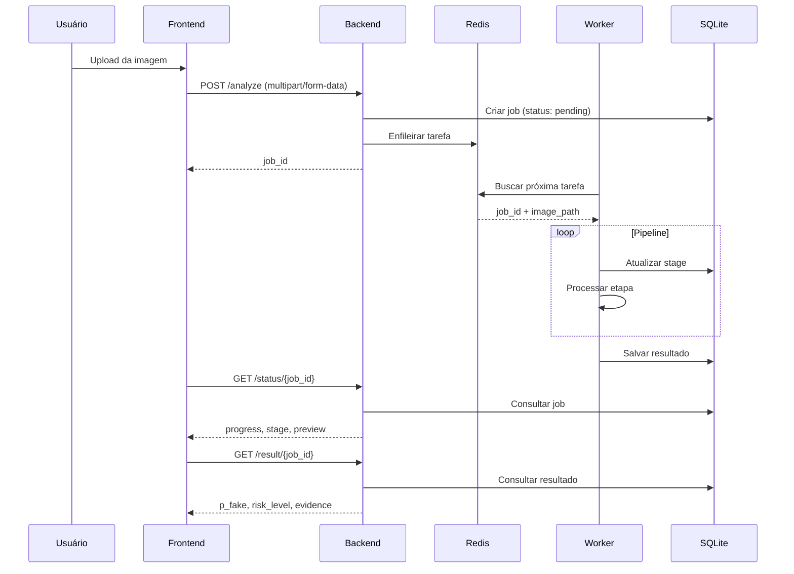

# 🏗️ Arquitetura do DeepTrustShield

## Visão Geral

O DeepTrustShield é um sistema distribuído de detecção de deepfake em imagens, composto por múltiplos serviços que trabalham em conjunto para processar, analisar e retornar resultados de forma assíncrona.

```
┌─────────────────────────────────────────────────────────────────────────┐
│                              Frontend                                    │
│                         (React + Vite + Nginx)                          │
│                             :3000                                        │
└─────────────────────────────────┬───────────────────────────────────────┘
                                  │ HTTP/REST
                                  ▼
┌─────────────────────────────────────────────────────────────────────────┐
│                               Backend                                    │
│                         (FastAPI + SQLAlchemy)                          │
│                              :8000                                       │
│  ┌─────────────────────────────────────────────────────────────────┐    │
│  │  Endpoints:                                                      │    │
│  │  POST /v1/deepfake/image/analyze    → Iniciar análise           │    │
│  │  GET  /v1/deepfake/image/status/:id → Consultar progresso       │    │
│  │  GET  /v1/deepfake/image/result/:id → Obter resultado final     │    │
│  └─────────────────────────────────────────────────────────────────┘    │
└─────────────────────┬──────────────────────────────┬────────────────────┘
                      │                              │
                      ▼                              ▼
         ┌────────────────────┐          ┌────────────────────┐
         │       Redis        │          │      SQLite        │
         │   (Job Queue)      │          │    (Database)      │
         │      :6379         │          │   detectar.db      │
         └─────────┬──────────┘          └────────────────────┘
                   │
                   │ RQ (Redis Queue)
                   ▼
┌─────────────────────────────────────────────────────────────────────────┐
│                               Worker                                     │
│                    (Python + PyTorch + MediaPipe)                       │
│  ┌─────────────────────────────────────────────────────────────────┐    │
│  │  Pipeline de Processamento:                                      │    │
│  │  1. Validação da Imagem                                         │    │
│  │  2. Detecção de Face (MediaPipe BlazeFace)                      │    │
│  │  3. Verificação de Qualidade (Blur, Brilho, Contraste)          │    │
│  │  4. Pré-processamento (Crop + Resize 224x224 + Normalização)    │    │
│  │  5. Inferência do Modelo (EfficientNet-B0/B3/B4)                │    │
│  │  6. Calibração do Score (Thresholds configuráveis)              │    │
│  │  7. Geração de Evidências (Face crop, Bounding box)             │    │
│  └─────────────────────────────────────────────────────────────────┘    │
└─────────────────────────────────────────────────────────────────────────┘
```

## Componentes

### 1. Frontend (React + Vite)

Interface web responsiva para upload de imagens e visualização de resultados.

| Tecnologia | Versão | Propósito |
|------------|--------|-----------|
| React | 18.x | Framework UI |
| Vite | 5.x | Build tool |
| Lucide React | - | Ícones |
| Nginx | Alpine | Servidor de produção |

**Porta:** 3000 (dev) / 80 (produção via Nginx)

### 2. Backend (FastAPI)

API REST que gerencia jobs, armazena resultados e serve artefatos.

| Tecnologia | Versão | Propósito |
|------------|--------|-----------|
| FastAPI | 0.109+ | Framework web assíncrono |
| SQLAlchemy | 2.0+ | ORM |
| Redis | 5.0+ | Conexão com fila |
| RQ | 1.16+ | Job queue client |
| Pydantic | 2.5+ | Validação de dados |

**Porta:** 8000

### 3. Worker (PyTorch + MediaPipe)

Processador de tarefas que executa o pipeline de detecção de deepfake.

| Tecnologia | Versão | Propósito |
|------------|--------|-----------|
| PyTorch | 2.2+ | Framework de deep learning |
| timm | 0.9+ | Modelos pré-treinados (EfficientNet) |
| MediaPipe | 0.10+ | Detecção de face |
| OpenCV | 4.9+ | Processamento de imagem |
| RQ | 1.16+ | Job queue worker |

**Filas:** `deepfake`

### 4. Redis

Broker de mensagens para comunicação entre Backend e Worker.

**Porta:** 6379

### 5. SQLite

Banco de dados para persistência de jobs, resultados e artefatos.

**Tabelas:**
- `jobs` - Estado dos jobs de processamento
- `results` - Resultados das análises
- `artifacts` - Metadados dos artefatos gerados

---

## Fluxo de Dados



---

## Estrutura de Diretórios

```
DeepTrustShield/
├── backend/                    # API FastAPI
│   ├── app/
│   │   ├── api/               # Endpoints (deepfake.py)
│   │   ├── db/                # Database models
│   │   ├── models/            # Pydantic schemas
│   │   ├── services/          # Business logic
│   │   ├── config.py          # Configurações
│   │   └── main.py            # Entry point
│   ├── Dockerfile
│   └── requirements.txt
│
├── worker/                     # Processador de tarefas
│   ├── app/
│   │   ├── pipeline/          # Etapas do pipeline
│   │   │   ├── face_detection.py
│   │   │   ├── preprocessing.py
│   │   │   ├── quality_checks.py
│   │   │   └── inference.py
│   │   ├── config.py
│   │   ├── db_models.py
│   │   └── tasks.py           # Task principal
│   ├── Dockerfile
│   └── requirements.txt
│
├── frontend/                   # Interface React
│   ├── src/
│   ├── public/
│   ├── Dockerfile
│   └── package.json
│
├── model/                      # Pesos dos modelos
│   └── weights/
│       └── *.pth
│
├── notebooks/                  # Scripts de treinamento
│   └── train_deepfake_detector_v*.ipynb
│
├── artifacts/                  # Artefatos gerados (runtime)
│   └── {job_id}/
│       ├── original.jpg
│       └── face_crop.jpg
│
├── docs/                       # Documentação
├── docker-compose.yml          # Orquestração Docker
├── podman-compose.yml          # Orquestração Podman
└── *.sh                        # Scripts de automação
```

---

## Variáveis de Ambiente

| Variável | Padrão | Descrição |
|----------|--------|-----------|
| `DATABASE_URL` | `sqlite:///./detectar.db` | URL do banco de dados |
| `REDIS_URL` | `redis://localhost:6379/0` | URL do Redis |
| `ARTIFACTS_PATH` | `./artifacts` | Diretório de artefatos |
| `MODEL_PATH` | `./model/weights` | Diretório dos pesos |
| `CORS_ORIGINS` | `http://localhost:3000` | Origens permitidas |

---

## Escalabilidade

O sistema foi projetado para escalar horizontalmente:

### Workers Múltiplos
```bash
# Iniciar múltiplos workers
rq worker deepfake --url redis://localhost:6379/0 &
rq worker deepfake --url redis://localhost:6379/0 &
rq worker deepfake --url redis://localhost:6379/0 &
```

### Containers
```yaml
# docker-compose.yml
services:
  worker:
    deploy:
      replicas: 3
```

### GPU
O worker detecta automaticamente CUDA e usa GPU se disponível:
```python
device = torch.device("cuda" if torch.cuda.is_available() else "cpu")
```

---

## Tolerância a Falhas

- **Retry automático**: Jobs falhos são reenfileirados
- **Timeout**: Jobs com timeout de 5 minutos
- **Estado persistente**: Progresso salvo no banco a cada etapa
- **Health checks**: Endpoints `/health` em cada serviço
